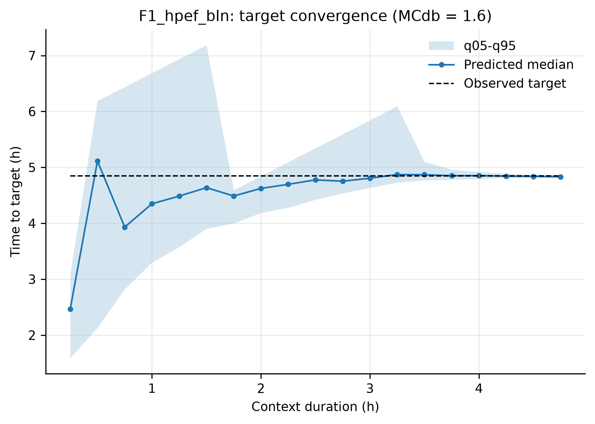

# Smart Drying with Timestral

A research prototype for **rolling forecasting and decision support in drying processes**, based on [Timestral by Mistral AI](https://github.com/mistralai/timestral).

The goal is to move from process monitoring to a simple operational prediction:

**How much time remains before the desired drying target is reached?**

The current implementation uses potato semi-drying as a case study, but the workflow is not specific to potatoes and is intended as a general approach for drying processes represented as time series.

## Why Timestral?

Traditional machine-learning approaches generally require a dedicated dataset and process-specific model training.

Timestral is a pre-trained foundation model for time series and can be used **zero-shot**: it receives the process history observed so far and forecasts its future evolution without additional training on our drying experiments.

This makes a different drying workflow possible:

**Conventional drying**

`process settings → elapsed time → operator assessment → stop`

**Timestral-supported drying**

`process measurements → rolling forecast → estimated time-to-target → operator decision`

As new measurements become available, the forecast is recalculated. The observed process history becomes longer and the remaining prediction horizon becomes shorter.

## First results

The first results are encouraging.

For a semi-drying target of **1.6 g H₂O/g dry matter**, after approximately **3–3.5 h** of process history, the median error in predicted time-to-target is approximately **1–2 min**. The target is typically reached after slightly more than **5 h**.

These predictions are obtained **without training Timestral on the experimental drying data**.

The figure shows how the estimated target time is progressively updated as additional process measurements become available.

## From forecasting to decision support

The purpose is not simply to predict a drying curve or minimize forecasting error.

The relevant output is the estimated **remaining time to a technological target**.

The current workflow evaluates:

- predicted time-to-target;
- remaining process time;
- prediction error at the target;
- moisture content at the predicted stopping time;
- evolution of forecast uncertainty as the process progresses.

The operator still defines the target and retains control of the process. Forecasting adds quantitative information to support that decision.

This is also the perspective behind the connection with **Industry 5.0**: using sensing and predictive AI to support human decision-making rather than simply increasing automation.

## Why local inference matters

Timestral is available in relatively compact configurations and can be executed locally.

This is particularly interesting for drying applications because it opens the possibility of running forecasting directly near the process, potentially on compact and relatively inexpensive computing hardware.

A future system could therefore combine:

`dryer sensors → local forecasting → time-to-target → operator`

Embedded deployment has not yet been benchmarked in this project and remains a development objective.

## Current case study

The current experimental case study concerns **hot-air semi-drying of sliced potatoes** under different technological conditions.

Moisture content on a dry basis (MCdb) is currently used as the forecasting variable, with several semi-drying targets evaluated.

The experimental work is part of a project funded by **COPAVIT (Acquapendente, Italy)** and is developed in collaboration with **BOKU Food Tech**.

The potato case study is used to develop and validate the methodology, not to define its application boundary. The same approach could be investigated for other foods, biomaterials and drying systems.

Future developments may include additional process information such as temperature, relative humidity, air velocity, product temperature and image-derived geometrical information.

## Workflow

The active pipeline is intentionally small:

- `scripts/01_timestral_rolling.py` — rolling forecast for one trajectory and one target;
- `scripts/02_timestral_validate_all.py` — validation across multiple trajectories and targets;
- `scripts/03_timestral_plots.py` — summary statistics and figures;
- `scripts/timestral_utils.py` — shared Timestral inference and evaluation functions.

Experimental data and generated results are currently kept local and are not distributed with this repository.

## Timestral

This project uses [**Timestral**](https://github.com/mistralai/timestral), developed by Mistral AI.

The current implementation uses zero-shot inference: Timestral model weights are **not trained or updated** using the drying experiments.

## Status

This repository is a **research prototype**, not a validated industrial process-control system.

Current development priorities include:

- validation on additional drying processes and materials;
- integration of physical and sensor-derived covariates;
- comparison of Timestral model sizes;
- benchmarking on low-cost edge hardware;
- evaluation of computational requirements for embedded deployment.

## License

This project is released under the **Apache License 2.0**.
